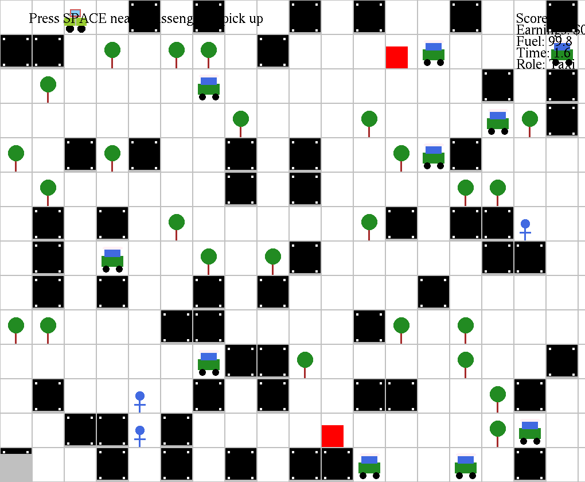
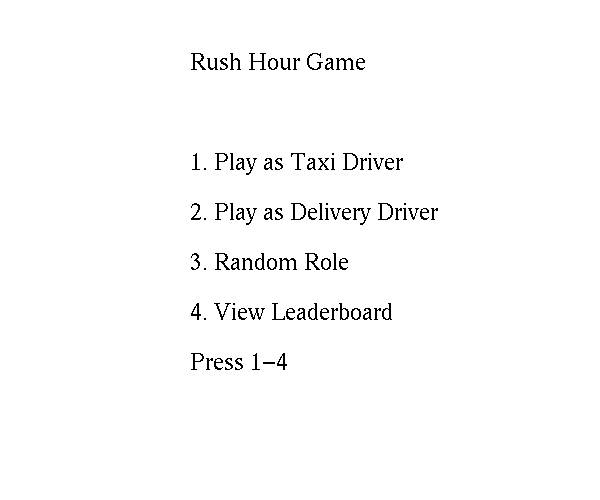

# 🚕 Rush Hour – 2D Taxi & Delivery Driving Game (C++ / OpenGL)

A single-player 2D city driving game built in **C++** with **OpenGL / GLUT**, made as the semester project for **CS1004 – Object Oriented Programming** at FAST-NUCES Islamabad (Spring 2025).

You play as either a **taxi driver** picking up passengers or a **delivery driver** collecting packages. You weave through a randomly generated city of buildings, trees and moving traffic, earn money for every job, and spend it on fuel before time runs out.

<p align="center">
  <br>
  <em>Taxi mode: the player's car (top-left) and passengers (blue stick figures), with traffic, buildings, trees and fuel stations (red)</em>
</p>

<p align="center">
  
</p>

---

## ✨ Features

- **Two playable roles**: Taxi Driver or Delivery Driver, or let the game pick one at random
- **Role switching mid-game**: drive to the grey garage in the bottom-left corner and press `P`
- **Randomly generated board** every game: an 18 × 14 grid with buildings, trees, passengers, delivery points and fuel stations
- **Moving traffic**: AI cars drive around the roads and turn when blocked
- **Fuel system**: fuel drains as you drive, and you refuel at stations using money you've earned
- **Increasing difficulty**: a new traffic car joins the board every 2 completed jobs
- **Role-specific map**: passengers only appear in taxi mode, and delivery points only in delivery mode
- **Persistent leaderboard**: the top 10 scores and player names, saved with **binary file handling**
- **HUD**: live score, earnings, fuel, elapsed time and current role

## 🧱 OOP Concepts Used

| Concept | Where it's used |
|---|---|
| **Abstraction** | `obstacles` is an abstract base class with a pure virtual `draw()` |
| **Inheritance** | `building`, `tree`, `ObstacleCar`, `Passenger`, `DeliveryPoint` and `FuelStation` all inherit from `obstacles` |
| **Polymorphism** | `Board` stores `obstacles*` pointers and calls `draw()` on each through the base-class interface |
| **Composition** | `Game` owns a `Board` and the player's `Car`; `Board` owns the grid and every entity on it |
| **Encapsulation** | Private state with getters and setters (`Car`, `Passenger`, `DeliveryPoint`, …) |
| **Dynamic memory** | Dynamically allocated 2D grid and entities, freed in destructors (virtual destructor on the base class) |
| **Singleton pattern** | `Game::getInstance()` gives the GLUT callbacks one shared game instance |
| **File handling** | Leaderboard read from and written to `highscores.txt` in binary mode |

## 🎮 Controls

| Key | Action |
|---|---|
| `1` / `2` / `3` | Main menu: Taxi / Delivery / Random role |
| `4` | View leaderboard |
| `↑ ↓ ← →` | Drive |
| `Space` | Pick up / drop off a passenger or package |
| `P` | Switch role (only at the grey garage, bottom-left) |
| `Esc` | Back to the main menu |
| `Enter` | Save your name to the leaderboard on the game-over screen |

## 📜 Rules & Scoring

| Event | Taxi | Delivery |
|---|---|---|
| Successful drop-off | **+10 pts**, +$50 | **+20 pts**, +$100 |
| Hit a building or tree | −2 pts | −4 pts |
| Hit another car | −3 pts | −5 pts |

- Refuelling costs **$20** for 50 units of fuel.
- In taxi mode, the passenger's destination is highlighted in **green** after pickup. In delivery mode, the drop-off point is shown in **red**.

**The game ends when:**
- 3 minutes have passed
- you run out of fuel
- your score drops below zero
- you reach **100 points**, which is a win 🏆

## 🛠️ Build & Run

> Tested on **Ubuntu / Linux**. On Windows, use **WSL** (Ubuntu) with WSLg so the game window can open.

**1. Install dependencies**
```bash
chmod +x install-libraries.sh
./install-libraries.sh
# or manually:
sudo apt-get install make g++ freeglut3-dev libglew-dev libfreeimage-dev
```

**2. Build**
```bash
make
```

**3. Run**
```bash
./game
```

The first time you save a score, the game creates `highscores.txt` for the leaderboard.

## 📁 Project Structure

```
.
├── game.cpp              # All game logic: classes, game loop, input, scoring, leaderboard
├── util.cpp / util.h     # Drawing helpers (shapes, text, colours) from the course starter code
├── CImg.h                # Image library used by the starter code's utilities
├── Makefile              # Build script
├── install-libraries.sh  # Installs the OpenGL/GLUT dependencies
└── screenshots/
```

## 🚀 Possible Improvements

- Sound effects for pickups, collisions and game start/end
- Speeding up traffic as the player completes more jobs
- Smooth, pixel-based movement instead of tile-by-tile
- A reachability check so every road cell is accessible on each generated map

## 🙏 Acknowledgements

- The graphics utility code (`util.cpp`, `util.h`) and the base project template were provided as course starter code by **Dr. Sibt Ul Hussain**.
- [CImg](https://cimg.eu/), the C++ image processing library.
- Game concept from the CS1004 OOP Spring 2025 project specification at FAST-NUCES Islamabad.

## 👤 Author

**Your Name**: [GitHub](https://github.com/your-username) · [LinkedIn](https://linkedin.com/in/your-profile)
